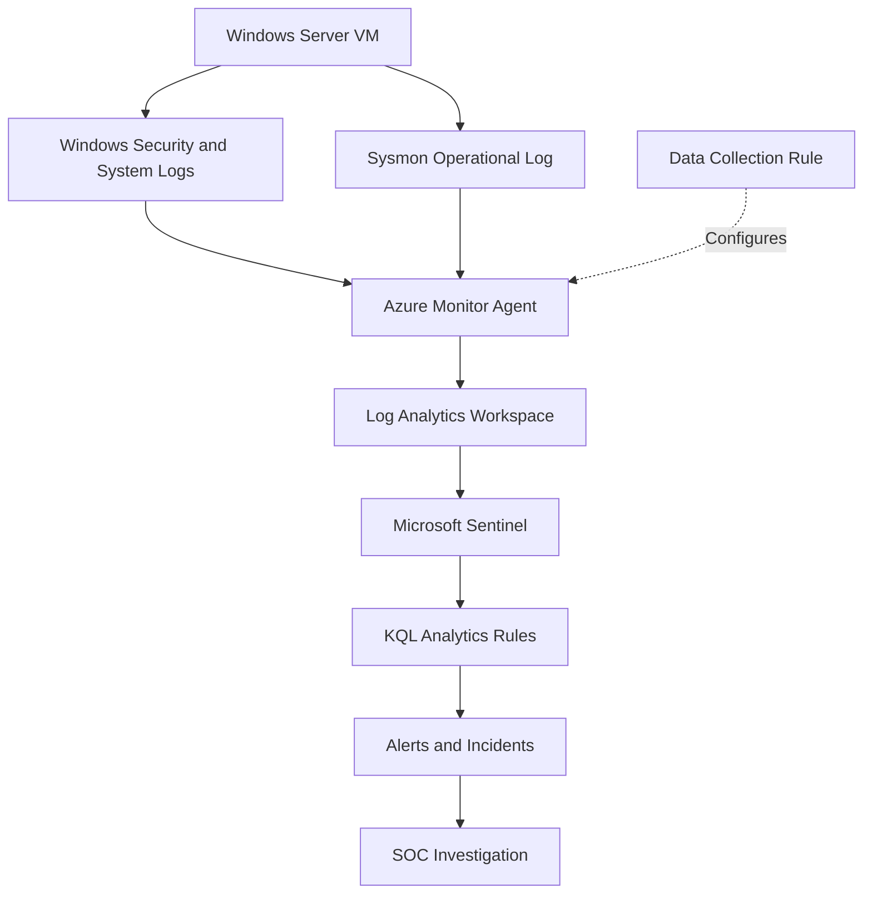

# Enterprise SIEM Architecture

## Architecture Explanation

Windows generates operating system and security events.
Sysmon adds detailed endpoint telemetry.
Azure Monitor Agent collects selected events according
to the Data Collection Rule and sends them to Log Analytics.

Microsoft Sentinel uses the workspace data for KQL
hunting queries, scheduled analytics rules, and incidents.
