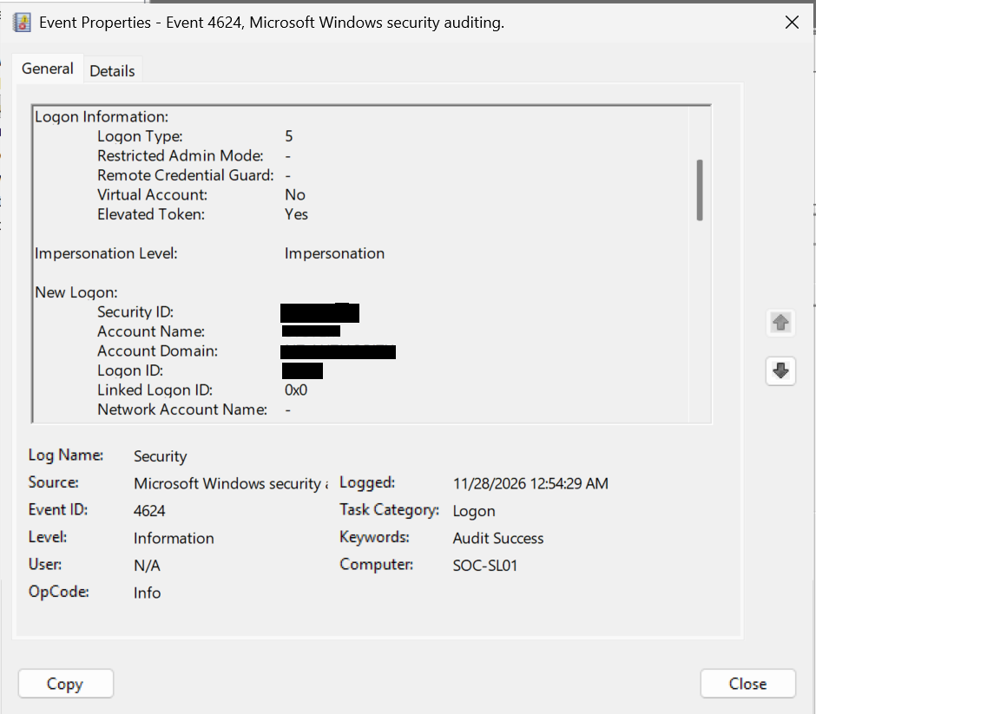

# Windows Security Event IDs — Log Analysis and Detection Engineering

## 1. Objective

The objective of this lab is to analyze Windows Security Event Logs, identify security-relevant event IDs, examine event attributes, and develop detection hypotheses for Microsoft Sentinel.

## 2. Lab Environment

| Component | Configuration |
|---|---|
| Operating system | Windows Server |
| Log source | Windows Security Event Log |
| Local analysis tool | Windows Event Viewer |
| SIEM | Microsoft Sentinel |
| Query language | KQL |
| Environment | Authorized cybersecurity lab |
| Validation status | In progress |

## 3. Windows Security Event ID Reference

| Event ID | Event Purpose | Fields to Inspect | Detection Idea |
|---|---|---|---|
| 4624 | Successful logon | TargetUserName, LogonType, IpAddress, WorkstationName | Successful logon following repeated failures |
| 4625 | Failed logon | TargetUserName, IpAddress, Status, SubStatus, LogonType | Brute-force or password-spray activity |
| 4672 | Special privileges assigned at logon | SubjectUserName, SubjectLogonId, PrivilegeList | Unexpected privileged logon |
| 4688 | New process created | NewProcessName, NewProcessId, CommandLine, SubjectUserName | Suspicious PowerShell execution |
| 4720 | User account created | TargetUserName, TargetSid, SubjectUserName | Unauthorized account creation |
| 4726 | User account deleted | TargetUserName, TargetSid, SubjectUserName | Unexpected account deletion |
| 4732 | Member added to a security-enabled local group | MemberName, MemberSid, TargetUserName, SubjectUserName | Unauthorized addition to an administrator group |
| 4740 | User account locked out | TargetUserName, TargetSid, CallerComputerName | Account lockouts associated with repeated authentication failures |
| 1102 | Security audit log cleared | SubjectUserName, SubjectDomainName, SubjectLogonId | Potential removal of forensic evidence |

The fields listed above are expected event attributes. Actual availability depends on the event version, audit policy, operating system and authentication method.

## 4. Detailed Event Analysis

### Event ID 4624 — Successful Logon

#### Event Purpose

Records a successful Windows authentication session.

#### Observed Fields

| Field | Observed Value |
|---|---|
| Event ID | 4624 |
| Log source | Windows Security |
| Account | REDACTED |
| Domain | REDACTED |
| Logon type | 5 |
| Source IP | [REDACTED or not populated] |
| Computer | REDACTED |
| Timestamp | UTC |

#### Detection Idea

Identify unexpected successful remote interactive
logons, particularly those occurring after multiple
failed authentication attempts.

#### Potential False Positives

- Authorized administrator access
- Legitimate remote desktop sessions
- Approved remote maintenance

#### MITRE ATT&CK Mapping

T1078 — Valid Accounts (when malicious use is established).

#### Screenshot Evidence



#### Validation Status

Pending — update after reviewing actual evidence.

### Event ID 4625 — Failed Logon

**Purpose:** Records an unsuccessful authentication attempt.

**Fields to inspect:**
- TargetUserName
- IpAddress
- LogonType
- FailureReason
- Status
- SubStatus

**Detection idea:** Identify five or more failed logons against the same account within a five-minute interval.

**MITRE ATT&CK:** T1110 — Brute Force.

**Potential false positives:** Incorrect passwords, expired credentials and misconfigured scheduled tasks.

**Observed fields:** Pending lab validation.

### Event ID 4672 — Special Privileges Assigned

**Purpose:** Records sensitive privileges assigned to a new logon session.

**Fields to inspect:**
- SubjectUserName
- SubjectDomainName
- SubjectLogonId
- PrivilegeList

**Detection idea:** Identify privileged logons involving accounts that do not normally require administrative access.

**Potential false positives:** SYSTEM accounts, authorized administrators and legitimate services.

This event alone does not establish privilege escalation.

**Observed fields:** Pending lab validation.

### Event ID 4688 — Process Creation

**Purpose:** Records the creation of a new process when process creation auditing is enabled.

**Fields to inspect:**
- NewProcessName
- NewProcessId
- CommandLine
- SubjectUserName
- Creator process information

**Detection idea:** Identify unusual PowerShell execution and investigate the associated command line, parent process and user context.

**MITRE ATT&CK:** T1059.001 — PowerShell.

**Potential false positives:** Administrative scripts, software deployment and legitimate automation.

Command-line information requires the appropriate audit configuration.

**Observed fields:** Pending lab validation.

### Event ID 4720 — User Account Created

**Purpose:** Records the creation of a new user account.

**Fields to inspect:**
- TargetUserName
- TargetDomainName
- TargetSid
- SubjectUserName
- SubjectLogonId

**Detection idea:** Identify unexpected account creation by an unauthorized or unusual administrative account.

**MITRE ATT&CK:** T1136 — Create Account.

**Potential false positives:** Authorized employee onboarding and legitimate account provisioning.

**Observed fields:** Pending lab validation.

## 5. Windows Logon Types

| Logon Type | Description |
|---|---|
| 2 | Interactive logon |
| 3 | Network logon |
| 4 | Batch logon |
| 5 | Service logon |
| 7 | Unlock |
| 8 | Network cleartext |
| 9 | New credentials |
| 10 | Remote interactive logon |
| 11 | Cached interactive logon |

Logon types provide context for authentication investigations.

## 6. Lab Validation Results

| Test ID | Event ID | Test Activity | Observed Result | Status |
|---|---|---|---|---|
| WIN-001 | 4624 | Successful lab account authentication | Pending | Not tested |
| WIN-002 | 4625 | Controlled incorrect password attempt | Pending | Not tested |
| WIN-003 | 4672 | Authorized administrator logon | Pending | Not tested |
| WIN-004 | 4688 | Launch a benign application | Pending | Not tested |
| WIN-005 | 4720 | Inspect account creation audit events | Pending | Not tested |

## 7. Detection Prototype — Repeated Failed Logons

**Detection hypothesis:** Multiple failed authentication attempts against the same account within a short period may indicate password guessing.

```kusto
SecurityEvent
| where TimeGenerated > ago(24h)
| where EventID == 4625
| where isnotempty(Account)
| summarize FailedAttempts = count()
    by Computer, Account, bin(TimeGenerated, 5m)
| where FailedAttempts >= 5
| sort by FailedAttempts desc
```

**Initial severity:** Medium.

**Data source:** Windows Security Events.

**Required table:** SecurityEvent.

**Validation status:** Pending.

The threshold is an initial lab hypothesis and requires positive testing, negative testing and false-positive tuning.

## 8. Screenshot Evidence

The following evidence will be added after successful lab validation and redaction.

| Evidence File | Description | Status |
|---|---|---|
| event-4624-successful-logon.png | Successful authentication event | Pending |
| event-4625-failed-logon.png | Failed authentication event | Pending |
| event-4672-privileged-logon.png | Privileged logon event | Pending |
| event-4688-process-creation.png | Process creation event | Pending |
| event-4720-account-creation.png | Account creation event | Pending |

Screenshots will be stored in the repository's `screenshots/windows-events/` directory.

All sensitive usernames, domain names, IP addresses, computer names and security identifiers will be redacted before publication.

## 9. Key Learning Outcomes

This lab is designed to develop practical skills in:

- Windows Security Event Log analysis
- Authentication event investigation
- Security telemetry interpretation
- Detection hypothesis development
- KQL query development
- MITRE ATT&CK mapping
- False-positive identification
- Security evidence documentation

## 10. References

- [Microsoft Windows Security Auditing](https://learn.microsoft.com/en-us/windows/security/threat-protection/auditing/)
- [Microsoft Sentinel Documentation](https://learn.microsoft.com/en-us/azure/sentinel/)
- [MITRE ATT&CK](https://attack.mitre.org/)

---

**Project:** Enterprise Detection Engineering Lab

**Phase:** Week 1 — SIEM Architecture, Log Sources and KQL

**Status:** In Progress
